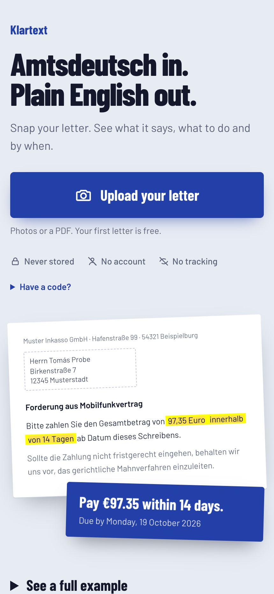
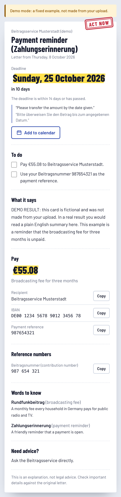
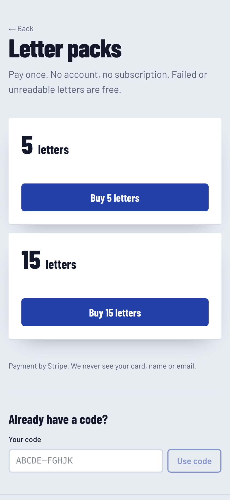

# Briefklar

**Understand official German letters in plain English.**

Briefklar is a web app for international students and newcomers in Germany. You take a photo of a letter from
the Finanzamt, the Ausländerbehörde, the Jobcenter, your landlord, an insurer or a debt collector, and you get a
clear action card: who sent it, what it means, what they want from you, and by when.

> **Status:** a personal project, not a public or commercial service. There is no hosted version: to try it, run
> it on your own computer (see below). A demo mode shows the whole flow without an API key. Nothing here is legal
> advice.

<table>
  <tr>
    <td align="center"><br><sub>Upload</sub></td>
    <td align="center"><br><sub>Action card (demo)</sub></td>
    <td align="center"><br><sub>Letter packs</sub></td>
  </tr>
</table>

## What it does

- **Reads the letter** from up to 4 photos or one PDF. Photos are resized in the browser first, which also
  handles iPhone HEIC images and keeps uploads small.
- **Explains it** in short, plain English: sender, letter type, summary, and what they want as a checklist.
- **Finds the deadline.** Printed dates are copied exactly. For periods such as "innerhalb eines Monats nach
  Bekanntgabe" it estimates a date, counted from the letter date to be safe, and labels it as an estimate.
- **Shows urgency:** "Act now" when the deadline is within 14 days or the letter mentions enforcement or court
  action, "Act before the deadline" otherwise.
- **Pulls out the details:** amount, recipient, IBAN, payment reference and reference numbers, each with a copy
  button, plus key German terms explained.
- **Points to the right help**, such as a Steuerberater, Mieterverein or Verbraucherzentrale, instead of giving
  legal advice.
- **Calendar and print:** add the deadline to your calendar (an .ics file made in the browser) or print the card
  as a PDF.
- **Free letter and packs:** one free letter per device, then prepaid letter packs through Stripe Checkout with a
  code instead of an account.

## How it works

```
Browser                         Server (/api/explain)                     Anthropic API
───────                         ─────────────────────                     ─────────────
resize photos to 1600 px  ──▶   validate input (Zod)
                                check free letter or credit code
                                send images or PDF + system prompt  ──▶   Claude reads the letter and returns
                                                                          JSON that matches the LetterCard schema
                                validate the JSON (Zod), retry once  ◀──
                                compute in code: estimated deadline,
                                urgency, referral
render the action card    ◀──   return the card (nothing is stored)
```

The model only extracts. Everything that can be decided by rules (deadline maths, urgency, which professional to
suggest) is plain, unit-tested code.

## Design principles

- **No letter is stored.** Uploads, extracted text and results stay in memory. Server logs contain only a request
  id, an error type and a status code. The only stored data is credit codes and hashed, short-lived usage counters.
- **Explain, never advise.** The app describes what a letter says and asks. It never says whether a letter is
  correct or what the reader should decide. In Germany, legal advice for an individual case is a regulated
  service.
- **Never invent facts.** A date, amount or reference number that isn't printed in the letter stays empty.
- **No tracking.** No analytics, no third party scripts, no external fonts, and a strict same-origin Content
  Security Policy.
- **EU first.** Functions are pinned to Frankfurt (`fra1`) on Vercel. Note that the Anthropic API cannot be pinned
  to the EU.

[`docs/data-flows.md`](docs/data-flows.md) lists exactly what data goes where.

## Tech stack

Next.js 16 (App Router) · TypeScript (strict) · Tailwind CSS 4 · Anthropic TypeScript SDK (Claude Sonnet 5.5,
structured outputs) · Zod · Stripe Checkout · Supabase Postgres · Vitest

## Run it on your own computer (demo mode, no API key)

The app is not online. These steps start it on your own machine, which takes a few minutes. You need
[Node.js](https://nodejs.org) 22 or later and git.

```bash
git clone https://github.com/Ilf-Ali-Momin/Klartext.git briefklar
cd briefklar
npm install
echo "LLM_MOCK=1" > .env.local
npm run dev
```

Then open http://localhost:3000 in your browser. `localhost` means your own computer, so this address only works
on the machine where you ran `npm run dev`.

Upload any photo. In demo mode the app returns a fixed, fictional card instead of calling the AI model, and the
page says so. The free letter limit still applies; to try again, clear the cookies for localhost or use a private
window. The screenshots at the top show what you will see.

## Run with real explanations

Copy `.env.example` to `.env.local`, remove `LLM_MOCK=1`, and fill in what you need:

| Variable | Needed for |
| --- | --- |
| `ANTHROPIC_API_KEY`, `LLM_MODEL` | explaining letters (`LLM_MODEL` defaults to `claude-sonnet-5-5`) |
| `STRIPE_SECRET_KEY`, `STRIPE_WEBHOOK_SECRET`, `STRIPE_PRICE_PACK5`, `STRIPE_PRICE_PACK15` | letter packs |
| `SUPABASE_URL`, `SUPABASE_SERVICE_ROLE_KEY` | credits and usage counters (required in production) |
| `IP_HASH_SALT` | hashing IP addresses for the daily free limit (required in production) |
| `NEXT_PUBLIC_APP_URL` | Stripe return URLs |
| `LLM_MOCK` | `1` for demo mode, development only |

Without Supabase, development keeps counters and credits in memory, so they reset on restart. `.env.local` is
ignored by git and must never be committed.

## Commands

```bash
npm run dev          # development server
npm run build        # production build
npm run lint
npm run typecheck
npm test             # unit tests
npm run eval         # runs the real model on the fixture letters and prints field accuracy (uses API credits)
npm run fixtures     # regenerates the synthetic fixture PDFs
```

## Testing

- **Unit tests** cover schema validation, deadline maths including month-end cases, urgency rules, referrals,
  the explain handler (free letter, credit codes, refunds, rate limits, no logging of letter content), payments
  (checkout, webhook signatures, idempotent credit creation), the calendar file and demo mode.
- **Eval:** [`fixtures/`](fixtures) holds three synthetic letters (fictional names and numbers) with the fields
  that must match exactly. `npm run eval` sends them through the real pipeline and prints accuracy per field. Real,
  redacted letters go in `fixtures/private/`, which is ignored by git.

## Project structure

```
app/                 pages (home, /buy, /success) and API routes (explain, checkout, Stripe webhook, code)
components/          uploader, result card and its parts
lib/llm/             schema, system prompt, model call with validation and retry, demo mode
lib/                 deadlines, referrals, credits, rate limits, calendar file, Stripe and Supabase clients
scripts/             eval and fixture generator
supabase/migrations/ tables and atomic Postgres functions for credits and usage counters
docs/                data flows and screenshots
```

keep.

## Deploy (optional)

- **Vercel:** [`vercel.json`](vercel.json) pins functions to `fra1`. Set the environment variables in the project
  settings.
- **Database:** run the SQL files in [`supabase/migrations/`](supabase/migrations) in order on a Supabase project
  in an EU region.
- **Stripe:** create two one-time EUR prices and a webhook for `checkout.session.completed` and
  `checkout.session.async_payment_succeeded` pointing to `/api/stripe/webhook`.

This is a personal project. Offering it to the public in Germany would need more, such as an Impressum, a privacy
policy and data processing agreements with every provider. See the owner launch checklist at the end of

## Disclaimer

Briefklar explains letters. It does not give legal advice. Always check important details against the original
letter.

## License

[MIT](LICENSE) © 2026 Ilf Ali Momin
